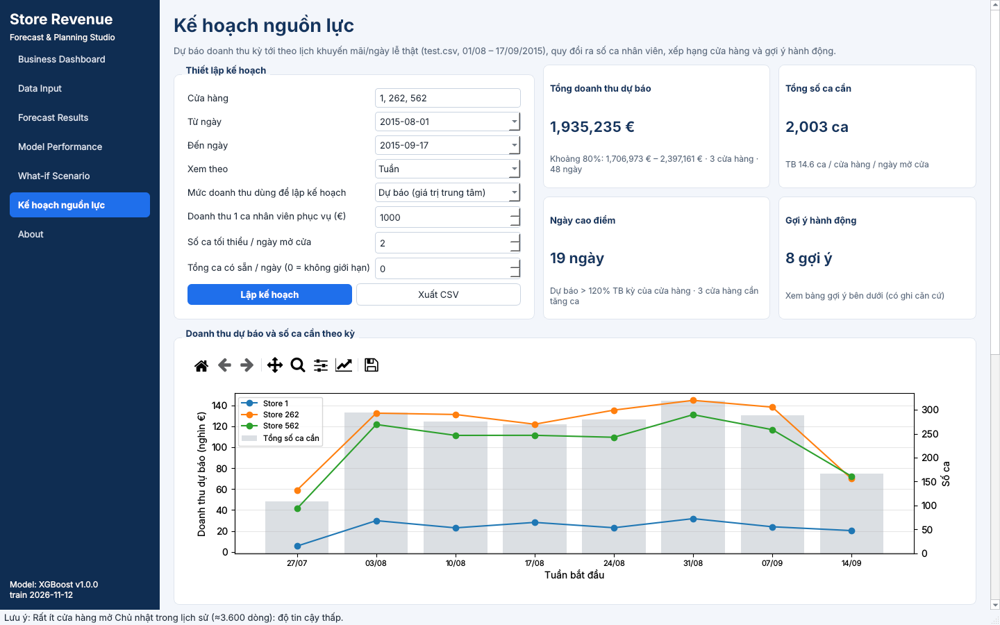

# XÂY DỰNG VÀ ỨNG DỤNG HỌC MÁY DỰ BÁO DOANH THU CỬA HÀNG BÁN LẺ KẾT HỢP MÔ PHỎNG KỊCH BẢN KINH DOANH VÀ LẬP KẾ HOẠCH NGUỒN LỰC

Đồ án môn *Học máy trong phân tích kinh doanh*, Khoa Hệ thống Thông tin, GVHD: TS. Trần Duy Thanh.

**Ứng dụng:** *Store Revenue Forecast & Planning Studio*, viết bằng PyQt6, dùng dữ liệu **Rossmann Store Sales** (1.115 cửa hàng, 2013–2015). Ứng dụng có các chức năng:

- Dự báo doanh thu cửa hàng theo **ngày, tuần, tháng**.
- So sánh và xếp hạng cửa hàng.
- **Mô phỏng kịch bản** khuyến mãi và ngày lễ (What-if).
- **Lập kế hoạch nguồn lực:** quy đổi doanh thu dự báo ra số ca nhân viên và đưa ra gợi ý hành động.



## 1. Cài đặt (một lần)

1. **Cài Python 3.12.** Khi cài, tick "Add python.exe to PATH". Không dùng 3.14 trở lên.
2. **Mở thư mục dự án bằng PyCharm.** Chọn interpreter Python 3.12 (có thể tạo virtualenv mới).
3. **Cài thư viện.** Mở cửa sổ Terminal của PyCharm và chạy:
   ```bash
   pip install -r requirements.txt
   ```

## 2. Chạy chương trình

Chạy **file kế thừa giao diện** theo cách đã học. Có hai cách, chọn một:

- Chuột phải **`main.py`** → **Run 'main'**.
- Chuột phải **`ui/MainWindowEx.py`** → **Run 'MainWindowEx'**.

Nếu dùng dòng lệnh thì chạy:

```bash
python main.py
```

Model đã train sẵn, dữ liệu có sẵn trong `datasets/`. Lần đầu mở, chương trình tự giải nén `datasets/train.zip` để nạp Dashboard; việc này mất vài giây.

## 3. Cấu trúc thư mục

```text
store-revenue/
├── main.py                    Chạy chương trình (giống TestSalesMainWindowEx.py)
├── requirements.txt           Thư viện cần cài
├── ui/                        GIAO DIỆN (PyQt6 + Qt Designer)
│   ├── MainWindow.ui          Thiết kế bằng Qt Designer
│   ├── MainWindow.py          Sinh bằng: pyuic6 -x ui/MainWindow.ui -o ui/MainWindow.py (không sửa tay)
│   ├── MainWindowEx.py        class MainWindowEx(Ui_MainWindow): setupUi, setupSignalAndSlot, showWindow
│   └── pages/                 Xử lý từng màn hình: Dashboard, Dự báo, Model Performance, What-if, Kế hoạch
├── src/                       XỬ LÝ DỮ LIỆU VÀ HỌC MÁY
│   ├── config.py              Đường dẫn và mốc chia dữ liệu
│   ├── data/loader.py         Đọc, kiểm tra, làm sạch dữ liệu, chia Train/Validation/Test theo thời gian
│   ├── features/pipeline.py   Tạo đặc trưng, mã hoá biến phân loại (dùng chung khi train và khi dự báo)
│   ├── models/                train.py (train và lưu model) · evaluate.py · predict.py · model_loader.py
│   └── services/              Dự báo, What-if, Kế hoạch nguồn lực, Dashboard, quản lý model
├── datasets/                  Dữ liệu Rossmann: store.csv, test.csv, train.zip; sample/ = CSV mẫu để demo
├── trained/                   Model đã train: sales_model.joblib + model_metadata.json
├── results/                   KẾT QUẢ
│   ├── figures/               Hình EDA (eda_*), kết quả mô hình (fig_*), ảnh giao diện (ui/),
│   │                          sơ đồ quy trình, kiến trúc và lưu đồ từng màn hình (diagrams/)
│   ├── evaluation/            Bảng so sánh mô hình, sai số, SHAP, thí nghiệm (CSV/JSON)
│   └── predictions/           File dự báo xuất ra
├── scripts/                   eda.py · experiments.py · prophet_experiment.py · whatif_examples.py · diagrams.py
└── tests/                     Unit test (pytest)
```

## 4. Các chức năng

| Màn hình | Chức năng |
|---|---|
| **Business Dashboard** | KPI doanh thu lịch sử, xu hướng theo tháng, top cửa hàng, so sánh cửa hàng, cảnh báo dự báo thấp |
| **Data Input** | Dự báo 1 bản ghi (Store, Date, Promo, StateHoliday, SchoolHoliday) hoặc nhiều bản ghi từ CSV, có kiểm tra dữ liệu đầu vào |
| **Forecast Results** | Doanh thu dự báo kèm khoảng min–max 80%, biểu đồ tổng theo **Ngày / Tuần / Tháng**, bảng chi tiết, sai số khi có Sales thật, xuất CSV |
| **Model Performance** | So sánh 2 baseline, Linear Regression, Decision Tree, Random Forest, XGBoost, LightGBM và Prophet theo RMSPE, MAE, MSE, RMSE, R². Có nút nạp lại model và train lại ngay trong ứng dụng |
| **What-if Scenario** | So sánh kịch bản gốc với kịch bản thay đổi: chênh lệch € và %. Xem đủ 8 tổ hợp Promo × ngày lễ |
| **Kế hoạch nguồn lực** | Chọn cửa hàng và kỳ kế hoạch (lịch khuyến mãi, ngày lễ thật trong `test.csv`, 01/08 – 17/09/2015). Ứng dụng dự báo doanh thu theo ngày/tuần/tháng kèm khoảng 80%, quy đổi ra **số ca nhân viên**, phân bổ ca khi tổng số ca bị giới hạn, xếp hạng cửa hàng so với cùng kỳ năm trước, và đưa ra **gợi ý** (tăng ca ngày cao điểm, xem lại vận hành, cân nhắc khuyến mãi, thiếu ca). Mỗi gợi ý ghi rõ căn cứ. Xuất được file CSV |
| **About** | Đề tài, dữ liệu, mô hình, nhóm thực hiện |

## 5. Mô hình và kết quả

**Cách xây dựng:**
- **Làm sạch:** giữ các ngày mở cửa có doanh thu, còn 844.338 dòng.
- **Chia theo thời gian:** Train ≤ 07/05/2015 · Validation 08/05 – 18/06/2015 · Test 19/06 – 31/07/2015.
- **Đặc trưng:** 24 đặc trưng, không dùng Customers.
- **Target:** `log1p(Sales)`.
- **Chọn mô hình:** theo RMSPE trên Validation. Test chỉ dùng để báo cáo.

**Kết quả** (nguồn: `results/evaluation/model_comparison.csv`):

| Mô hình | Val RMSPE | Test RMSPE | Test MAE | Test RMSE | Test R² |
|---|---:|---:|---:|---:|---:|
| Baseline A (TB Store–Thứ–Promo) | 0,1531 | 0,1475 | 749 | 1115 | 0,866 |
| Baseline B (52 tuần trước) | 0,1734 | 0,1631 | 804 | 1210 | 0,842 |
| Linear Regression (one-hot Store, thứ, tháng, năm) | 0,2738 | 0,2612 | 1105 | 1578 | 0,731 |
| Decision Tree | 0,2301 | 0,2327 | 1145 | 1703 | 0,687 |
| Random Forest | 0,2120 | 0,2124 | 1095 | 1631 | 0,713 |
| **XGBoost (được chọn)** | 0,1389 | **0,1459** | **735** | **1072** | **0,876** |
| LightGBM | 0,1510 | 0,1551 | 775 | 1126 | 0,863 |
| Prophet (mỗi cửa hàng 1 mô hình) | **0,1358** | 0,1540 | 765 | 1111 | 0,867 |

**Nhận xét:**
- **Linear Regression và Decision Tree** (các mô hình trong bài học) kém hơn rõ rệt. Quan hệ giữa doanh thu và các yếu tố là phi tuyến, nên các mô hình boosting phù hợp hơn.
- **XGBoost** có Val RMSPE thấp nhất trong các mô hình dùng chung một mô hình cho mọi cửa hàng, nên được chọn. Trên Test, XGBoost cũng tốt nhất theo RMSPE, MAE, RMSE và R².
- **Prophet** có Val RMSPE thấp nhất (0,1358), nhưng kết quả trên Test kém hơn XGBoost. Nhóm không đưa Prophet vào ứng dụng vì phải duy trì 1.115 mô hình riêng và cần thêm thư viện Prophet/Stan. Prophet được chạy riêng để so sánh: `scripts/prophet_experiment.py`.
- **So với Baseline A trên Test RMSPE:** chạy 5 seed cho XGBoost ra 0,146–0,155, nên chưa đủ cơ sở kết luận XGBoost tốt hơn Baseline A ở chỉ số này (`results/evaluation/experiment_seed_stability.csv`).
- **SHAP:** Promo là đặc trưng ảnh hưởng mạnh nhất tới dự báo (`results/figures/fig_shap_importance.png`).
- **Khoảng dự báo 80%:** trên Test, bao phủ 80,3% giá trị thật.

**Giới hạn:**
- What-if là mô phỏng theo mô hình, không chứng minh quan hệ nhân quả.
- Dữ liệu ngày lễ rất ít, nên mô hình chỉ phân biệt có hay không có ngày lễ, không phân biệt a/b/c.
- Lịch sử không có ngày nào Promo rơi vào cuối tuần, nên các kịch bản này là ngoại suy.
- **Kế hoạch nguồn lực:**
  - "Doanh thu 1 ca" là giả định do người dùng nhập, vì dữ liệu Rossmann không có số liệu nhân sự.
  - Lịch kỳ tới chỉ có cho 856 cửa hàng có trong `test.csv`.
  - Gợi ý được tạo theo quy tắc để hỗ trợ quyết định, không phải lời giải tối ưu.

## 6. Lệnh dành cho người phát triển

| Việc | Lệnh |
|---|---|
| Train lại model, sinh bảng và hình kết quả (~1,5 phút) | `python -m src.models.train` |
| EDA, sinh `results/figures/eda_*.png` | `python scripts/eda.py` |
| Thí nghiệm seed và mã hoá loại ngày lễ (~3 phút) | `python scripts/experiments.py` |
| Prophet cho từng cửa hàng (~1–6 phút, chạy trước `train` để thêm vào bảng so sánh) | `pip install prophet` rồi `python scripts/prophet_experiment.py` |
| Ví dụ What-if | `python scripts/whatif_examples.py` |
| Vẽ lại sơ đồ và lưu đồ (cần cài Graphviz) | `python scripts/diagrams.py` |
| Dự báo từ CSV bằng dòng lệnh | `python -m src.models.predict --csv datasets/sample/sample_input.csv` |
| Unit test | `python -m pytest` |
| Sinh lại code giao diện sau khi sửa `.ui` | `pyuic6 -x ui/MainWindow.ui -o ui/MainWindow.py` |

## 7. Nhóm thực hiện

Nguyễn Gia Bảo · Bùi Thị Khánh Hà · Lê Trần Ngọc Huyên · K Thị Lụa · Nguyễn Phan Bảo Hân · Lê Vy
